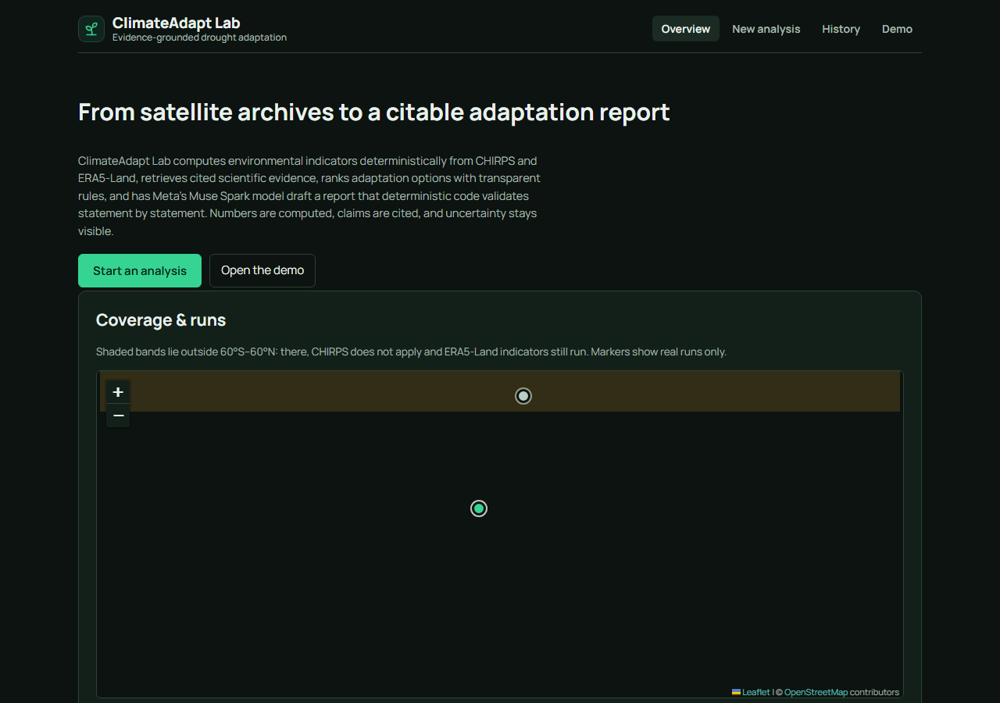
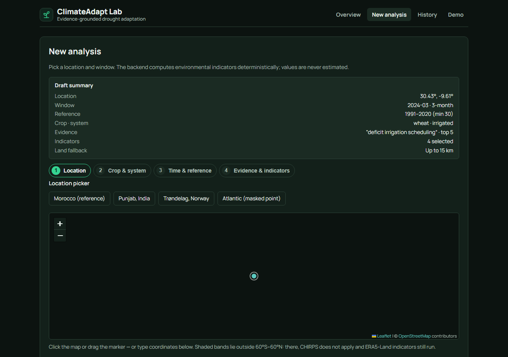
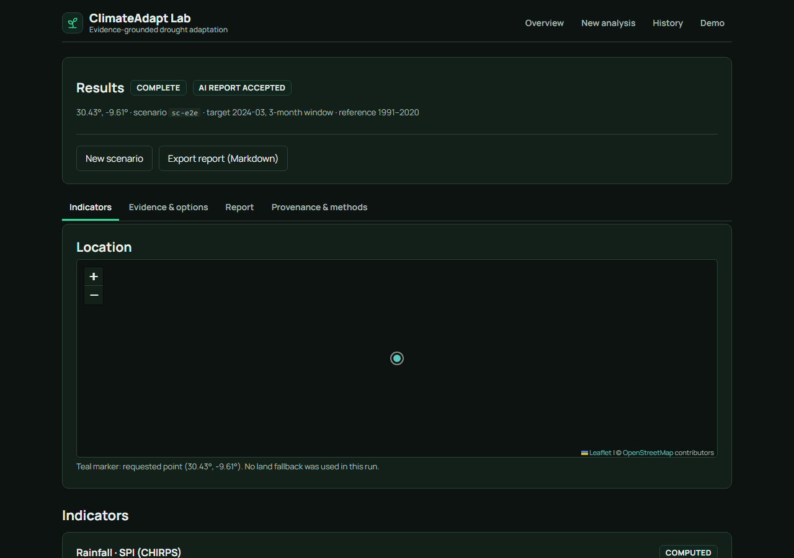
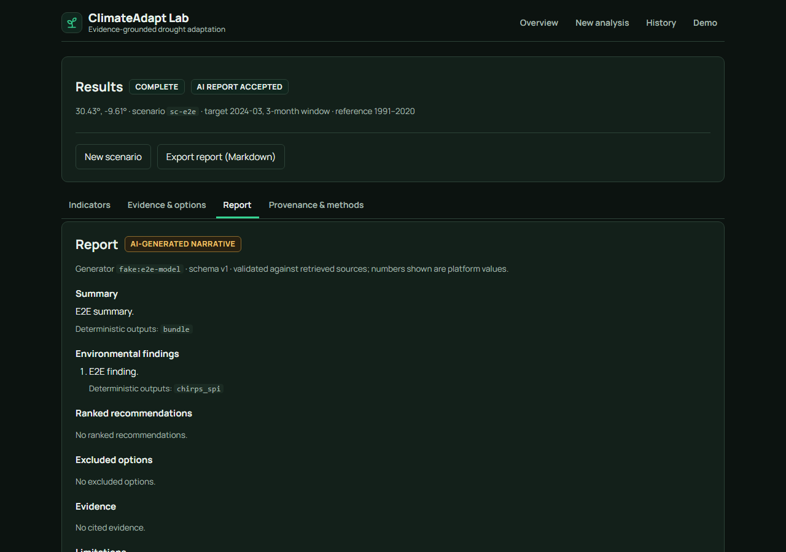
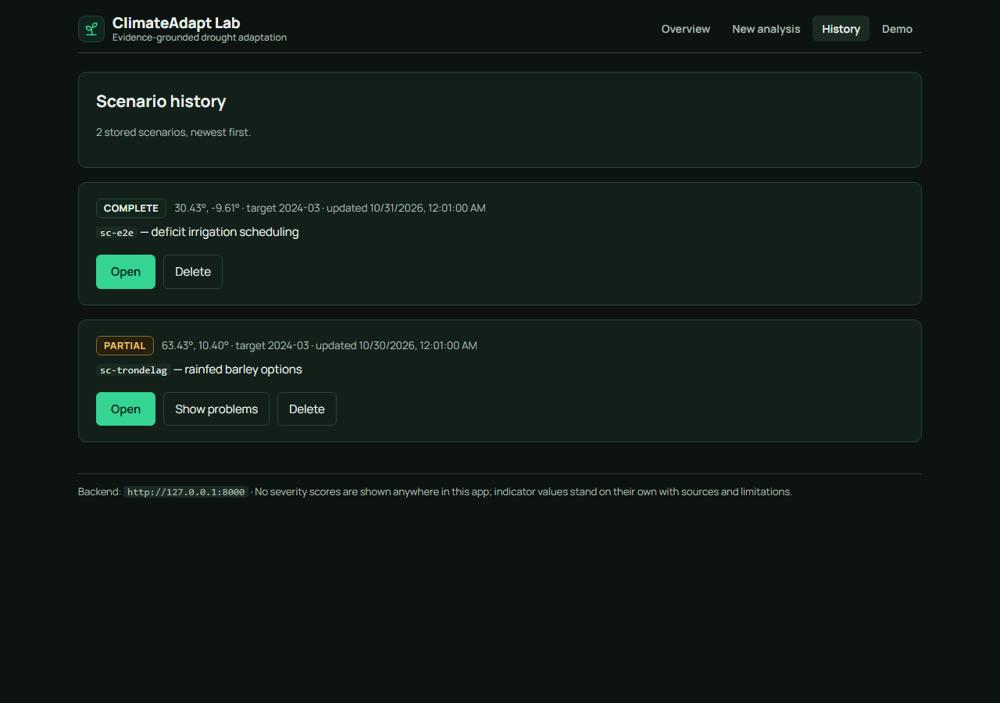

# ClimateAdapt Lab

Evidence-grounded AI agent for agricultural drought adaptation (Meta Global
Developer AI Hackathon project). Pick a location and season: the platform
computes environmental indicators from CHIRPS and ERA5-Land, retrieves cited
scientific evidence, ranks adaptation options with deterministic rules, and has
Meta's Muse Spark model draft a validated, traceable report. Deterministic
Python computes and enforces; the LLM only explains — every number is computed,
every claim is cited, and uncertainty stays visible. No severity scores, no
invented benefits, no hidden imputation.



**Status (P21, 2026-11-02):** backend 792 passed + 84 sandbox-blocked socket
tests (zero assertion failures), frontend 96/96 Vitest + 7/7 Playwright,
`ruff check .` clean; details in `docs/handoff/IMPLEMENTATION_STATUS.md`,
issues in `docs/handoff/KNOWN_ISSUES.md`, evidence in
`docs/FINAL_VERIFICATION.md`, submission checklist in
`docs/SUBMISSION_CHECKLIST.md`.

## Quickstart — zero keys (~5 minutes)

Prereqs: Python 3.11 + `uv`, Node 20.19+ (or Docker instead of a local Node — see "Docker demo stack").

```powershell
git clone <repo-url>; cd climateadapt-lab
uv sync --extra dev
$env:CLIMATEADAPT_DEMO_MODE = 'true'
uv run uvicorn climateadapt.api.main:app --reload   # http://127.0.0.1:8000/docs
cd frontend; npm install; npm run dev               # http://localhost:5173
```

Open http://localhost:5173 and click **Demo**: four audited real-data
snapshots (Morocco 4/4 indicators ok, Morocco-AI with the accepted Muse Spark
report, Norway with CHIRPS `outside_coverage`, Atlantic with ERA5
`missing_data` on a masked point) — zero keys, zero new model calls, zero
downloads, no `.env` needed. Live CHIRPS reads also work without
credentials; only fresh ERA5-Land downloads need a Copernicus account file.

## With a model key — live reports

```powershell
copy .env.example .env   # then set CLIMATEADAPT_BASETEN_API_KEY in .env (never commit it)
$env:CLIMATEADAPT_RUN_LIVE_LLM = "1"; uv run python scripts/llm_smoke.py   # ≈$0.002 check
```

New scenarios then draft reports with `meta-models/muse-spark-open-1026`
through Baseten; drafts that fail client-side validation fall back to the
labelled deterministic report. One model draft has been accepted
(run 2026-11-02, 14/14 statements validated — see
`docs/MUSE_SPARK_EVIDENCE.md`); fallback remains the normal outcome whenever
validation fails (KI-35).
Full key setup: "Add your model key" below and `docs/LLM_PROVIDER_NOTES.md`.

## Implemented / Not implemented (honest list)

Implemented: CHIRPS + ERA5-Land point connectors with provenance and coverage
gates; precipitation, SPI, temperature, and soil-moisture indicators; BM25 +
dense-E5/Qdrant hybrid retrieval with verified citations; versioned
intervention catalog with deterministic constraints and transparent ranking;
fixed 7-stage agent pipeline where the model drafts, the platform validates every statement, failing statements are replaced by deterministic counterparts, and the labelled deterministic fallback ships if the whole report cannot be validated;
scenario API + SQLite history; React UI (map picker, results map, cited
report, demo page); tracked demo snapshots; Dockerfiles + compose stack +
CI workflow; classical CropHarvest vision baseline (MLflow-tracked).

Not implemented: LangGraph (fixed validated pipeline chosen by recorded
decision, `docs/AGENT_WORKFLOW.md`); Airflow, Grafana, PostgreSQL, Prometheus,
Evidently, Optuna (core-only decision, KI-30); MLflow anywhere except the
vision baseline; vision model deployment (trained and evaluated locally only);
RAG API routes; any hosted deployment (local + compose only). One accepted
model draft is captured as a demo snapshot (KI-35 resolved 2026-11-02 —
see `docs/MUSE_SPARK_EVIDENCE.md`); future runs may still fall back.

## Scientific scope and limitations

- Indicators implemented: precipitation **percentage anomaly**, **SPI** (gamma fit per calendar
  month, WMO-No. 1090), and ERA5-Land **temperature** and **soil-moisture window
  anomalies** (difference, standardized anomaly, empirical percentile). All are
  *relative to a reference period*. None measures drought impact, and none returns
  severity labels.

- The percentage anomaly is mean-based and can mislead on skewed rainfall records. SPI is more
  appropriate, but its gamma fit is not goodness-of-fit tested; `scripts/spi_diagnostics.py`
  reports how sensitive SPI is to that assumption.
- Data: CHIRPS v3 Final (monthly, 0.05 degree, 60S-60N, 1981-present) and ERA5-Land monthly
  means (0.1 degree reanalysis, 1950-present). Coverage, units, provenance, and limitations are
  returned with every result. No global validation is claimed.
- **Products can disagree.** In one real test (Jan-Mar 2024, one point) CHIRPS and ERA5-Land
  gave SPI-3 of -0.52 and -0.38 with a 0.77 yearly correlation, but quite different monthly
  totals. Use `scripts/spi_compare.py` and treat disagreement as uncertainty.
- Missing values are never converted to zero and never partially summed. Reference years with
  incomplete windows are excluded and reported, never imputed.
- ERA5-Land has no value at masked (for example sea) grid points. By default months are
  reported as missing. The opt-in `--land-fallback-km` uses the nearest valid neighbour and
  always reports the substitution.
- A point exactly on a CHIRPS cell edge or corner is flagged. Use points that are not
  multiples of 0.05 degrees.

## Data sources and licences

- CHIRPS v3 Final (UC Santa Barbara Climate Hazards Center; monthly precipitation, 0.05 degree, 60S-60N, 1981-present). Citation and terms are served with every result (`CITATION`, `LICENSE_NOTE` in `src/climateadapt/data/chirps.py`): Funk, C. et al., Scientific Data 13, 718 (2026), https://doi.org/10.1038/s41597-026-07096-4; data DOI https://doi.org/10.15780/G2JQ0P; "Public domain / CC BY 4.0 as stated by the Climate Hazards Center and the Scientific Data descriptor."
- ERA5-Land monthly means (Copernicus Climate Change Service, CDS; 0.1 degree reanalysis, 1950-present). Copernicus licence terms apply; the dataset's terms of use must be accepted in the CDS before downloading; acknowledge "Copernicus Climate Change Service Information" and check the dataset page for the current licence text (served as `LICENSE_NOTE` in `src/climateadapt/data/era5_land.py`).
- CropHarvest v14 (vision baseline only; Zenodo record 10251170): CC-BY-SA-4.0. Never used as drought or intervention evidence — see `docs/VISION_BASELINE.md` §1.
- Evidence corpus: 8 curated sources (FAO, WMO, journals, ICARDA) with mixed licences, some NC/ND — see `corpus/manifest.json` (`license`, `license_status`, `unverified_fields` per document). Only the manifest + `corpus/eval/` are versioned; PDFs and extracted text are never committed (KI-23).
- Dependencies are permissive-licensed (MIT / BSD / Apache-2.0 family; full table in `docs/FINAL_VERIFICATION.md` §4) with one exception: `react-leaflet` 5.0.0 + `@react-leaflet/core` 3.0.0 are **Hippocratic-2.1** (ethical-source licence, not OSI-approved — see KI-36; Leaflet itself is BSD-2-Clause). No GPL/AGPL dependency: the closest cases are tqdm (MPL-2.0 AND MIT dual) and matplotlib's bundled FreeType (FTL-or-GPL at the user's choice).
- Map tiles (frontend only, no key needed): OpenStreetMap standard tiles (`https://tile.openstreetmap.org/{z}/{x}/{y}.png`), © OpenStreetMap contributors (ODbL), attributed on every map per the [Tile Usage Policy](https://operations.osmfoundation.org/policies/tiles/) (read 2026-11-02; demo-scale viewing complies — no scraping, browser User-Agent/Referer, no restrictive Referrer-Policy). No geocoding service is used. Library sources: [react-leaflet v5 installation](https://react-leaflet.js.org/docs/start-installation/) (React 19 peers confirmed in the installed `package.json`: `react`/`react-dom` ^19, `leaflet` ^1.9.0), [Leaflet](https://leafletjs.com/) (BSD-2-Clause). No CSP exists in `index.html` or `nginx.conf`, so none needed updating for tiles.

## Setup (repo root, PowerShell)

```powershell
uv sync --extra dev
copy .env.example .env
uv run pytest
uv run ruff check .
```

The suite takes about 10 minutes (verified 9 min 36 s on 2026-10-30: 536 passed;
it builds many synthetic rasters). Optionally run in parallel: `uv run --with pytest-xdist pytest -n auto`.

## Run the API

```powershell
uv run uvicorn climateadapt.api.main:app --reload
```

Docs: http://127.0.0.1:8000/docs

| Endpoint | Purpose |
|---|---|
| `GET /health` | Liveness and version |
| `POST /v1/analysis/rainfall-anomaly` | Prototype anomaly from user-supplied totals |
| `POST /v1/analysis/chirps-rainfall-anomaly` | Percentage anomaly computed from CHIRPS v3 Final |
| `POST /v1/analysis/chirps-spi` | SPI from CHIRPS v3 Final (default reference 1991-2020) |
| `POST /v1/analysis/era5-spi` | ERA5-Land SPI as a background job (202 + poll) |
| `POST /v1/analysis/era5-temperature-anomaly` | ERA5-Land temperature anomaly as a job |
| `POST /v1/analysis/era5-soil-moisture-anomaly` | ERA5-Land soil-moisture anomaly as a job (layers 1-3) |
| `POST /v1/analysis/environmental-bundle` | CHIRPS SPI + ERA5 trio as one job; per-indicator statuses |
| `GET /v1/jobs/{job_id}` | Poll a job: queued / running / succeeded / failed / timed_out |
| `POST /v1/scenarios` | Create a scenario: queue one bounded agent run (202 + ids) |
| `GET /v1/scenarios` | List stored scenarios, newest first (paginated) |
| `GET /v1/scenarios/{id}` | Retrieve bundle, ranking, report, and trace |
| `DELETE /v1/scenarios/{id}` | Delete a stored scenario |

ERA5-Land endpoints never block: each POST returns 202 with a `job_id` immediately
and the client polls `GET /v1/jobs/{job_id}` (per-job timeout 900 s, results kept
1 hour; see `CLIMATEADAPT_API_*` in `.env.example`). The bundle reports every
indicator separately (`ok` / `undefined` / `failed` / `skipped`) with its result
or typed error, provenance, limitations, and grid cells — never a composite score
or severity label. CHIRPS endpoints stay synchronous. Full contract: `docs/openapi.json`.

Scenarios (the React frontend contract): `POST /v1/scenarios` validates the
request, persists it to SQLite (`data/scenarios.sqlite3` by default), queues
one fixed-pipeline agent run, and returns 202 with `scenario_id` and `job_id`.
`GET /v1/scenarios/{id}` returns the stored input, deterministic bundle and
ranking, and either the validated report (`complete`) or the labelled fallback
(`partial`), plus the trace, problems, and warnings. History is paginated
(`limit` 1-100, `offset`). All scenario responses carry `"version": 1`; the
frontend must gate on it. Request bodies over 1 MB get 413
(`request_too_large`). Error codes: `scenario_not_found` (404), `job_not_found`
(404), `server_busy` (503), plus the analysis codes. **No authentication:**
anyone who can reach the server can create, read, and delete scenarios; do not
expose it beyond localhost without adding auth. Regenerate the contract after
any route change with `uv run python scripts/export_openapi.py`; generate the
frontend client from `docs/openapi.json` (e.g. `openapi-typescript`) rather
than hand-writing it, and keep a contract test against the `version` field.

```powershell
# Create a scenario (needs warm caches for an offline run; without a Baseten
# key the report is the labelled deterministic fallback -- no credits spent)
$body = @{
  latitude = 30.43; longitude = -9.61; target_end_month = "2024-03"
  timescale_months = 3; reference_start_year = 1991; reference_end_year = 2020
  min_reference_years = 30; land_fallback_max_km = 15.0
  query = "deficit irrigation scheduling"; top_k = 5
  crop = "wheat"; has_water_source = $true
  has_irrigation_equipment = $true; production_system = "irrigated"
  season = "2024-03"
} | ConvertTo-Json
$created = Invoke-RestMethod -Uri http://127.0.0.1:8000/v1/scenarios `
  -Method Post -Body $body -ContentType "application/json"
$created.scenario_id; $created.job_id

# Poll the job, then read the stored result
Invoke-RestMethod http://127.0.0.1:8000/v1/jobs/$($created.job_id)
Invoke-RestMethod http://127.0.0.1:8000/v1/scenarios/$($created.scenario_id)

# History (paginated) and deletion
Invoke-RestMethod "http://127.0.0.1:8000/v1/scenarios?limit=20&offset=0"
Invoke-RestMethod http://127.0.0.1:8000/v1/scenarios/$($created.scenario_id) -Method Delete
```

## Run the frontend

Prereqs: Node 20.19+ (Vite 8; the system Node here is v16.13.1, so P12 was
built and verified with a portable Node v26.13.0 + npm 11.20.0 — see
`docs/handoff/IMPLEMENTATION_STATUS.md` §2.14). If Node is older than 20.19,
install Node 22 LTS or use `docker compose up --build`, which builds the
frontend with Node 22. Start the API first (above),
then:

```powershell
cd frontend
copy .env.example .env   # VITE_API_BASE_URL only (public value, no secrets)
npm install
npm run dev              # strict port 5173, matching the API CORS default
```

`npm run lint`, `npm run test` (Vitest, 96 tests), `npm run build` (`tsc` +
`vite build`). End-to-end (local only, needs system Chrome; CI does not run
it): `npm run build:e2e`, then `npm run test:e2e` (Playwright, 7 tests incl.
map interaction + screenshot capture). After any backend route change,
regenerate the typed client with `npm run gen:api` (openapi-typescript from
`docs/openapi.json`); a contract test fails on drift.

What the app does (P12): a validated scenario form (lat/lon with coverage
hints, window, reference period, crop, water flags, ERA5 land-fallback toggle),
job progress with polling/timeout/keep-waiting, and one results card per
indicator (value, units, reference period, source + coverage, status,
limitations, provenance, fallback/cell-edge warnings) with a reference-summary
chart. No composite scores or severity labels are rendered anywhere; every API
error `type` code maps to one specific message. P13 delivered the cited report (every claim with evidence links and platform-value chips, AI-vs-platform labels, fallback banner, always-visible limitations), the deterministic ranking panel (score breakdowns, unknowns, excluded reasons), scenario history with open/delete, and one-click Markdown export.
P20 added an interactive Leaflet map: click/drag picking two-way synced with
the coordinate inputs, CHIRPS 60°S–60°N band shading with an outside-band note,
and one-click presets matching the four captured snapshots (Morocco, Punjab,
Norway, Atlantic). The results page opens with a summary strip (location,
window, reference period, status, "AI report accepted" vs "Platform fallback
report" badge) and anchored sections; per-card limitations/provenance and the
grouped validator problems sit in collapsed expandables with counts, while
report limitations stay always visible. Map markers distinguish the requested
point (teal) from ERA5-Land grid points actually used via land fallback
(ochre, with the backend-reported distance).
Out of scope: authentication, mobile polish.

Screenshots (P26 Playwright run, mocked backend — map tiles need network, so
they render blank in offline sandboxes; re-capture on a networked machine with
`npm run build:e2e`, `npm run test:e2e`, then copy
`frontend/test-results/screenshots/*.png` to `docs/screenshots/`):







## Demo mode (zero keys needed)

The fastest path on a fresh clone — no Baseten key, no CDS credentials, no
corpus, no caches. The repo ships four audited real-data snapshots in tracked
`demo/snapshots/` (see `demo/README.md` for the audit + licence notes):

```powershell
uv sync --extra dev
$env:CLIMATEADAPT_DEMO_MODE = 'true'
uv run uvicorn climateadapt.api.main:app --reload
```

Then open the frontend Demo page (`#/demo`, see "Run the frontend" below) or
call the API directly:

```powershell
Invoke-RestMethod http://127.0.0.1:8000/v1/demo/snapshots
Invoke-RestMethod http://127.0.0.1:8000/v1/demo/snapshots/reference-morocco
```

`GET /v1/demo/snapshots` lists captures; `GET /v1/demo/snapshots/{key}`
returns one verbatim. With the flag off both answer 404
(`demo_mode_disabled`); unknown keys answer 404
(`demo_snapshot_not_found`). Shipped keys: `reference-morocco` (all four
indicators ok, fallback report), `reference-morocco-ai` (same point, accepted
Muse Spark report — see `docs/MUSE_SPARK_EVIDENCE.md`), `trondelag-norway`
(CHIRPS `outside_coverage`, ERA5 ok), `atlantic-ocean` (ERA5 `missing_data`
on a masked point). Every snapshot view
carries a "Cached real-data snapshot" banner with the capture timestamp —
stored results are never presented as live ones. Capture your own with
`uv run python scripts/capture_demo_snapshot.py --key <k> --label "<label>"
--lat <lat> --lon <lon>` (deterministic, zero model calls; writes to tracked
`demo/snapshots/` by default — audit before committing — or `--out-dir` for
private captures). See `docs/DEMO_RUNS.md` (real results at four locations)
and `docs/DEMO_SCRIPT.md` (walk-through + fallback plan).

## Docker demo stack

P15. Backend image (Python 3.11 slim + `uv sync`; rasterio/scipy install from
wheels, no GDAL build; the `dense` extra is excluded) and frontend image (Node
22 build, nginx serve), orchestrated by `docker-compose.yml`. Host `./data`
(caches, corpus text, sqlite) is bind-mounted so images stay small and warm
caches are reused; `.dockerignore` keeps `data/`, `.env` files, and corpus
text out of the images. No secrets in images — copy `.env.docker.example` to
the untracked `.env.docker` for overrides (a real Baseten key belongs only
there or in the shell environment):

```powershell
docker compose up --build
```

Backend: http://127.0.0.1:8000 (`/health`, `/docs`); frontend:
http://localhost:5173 (matches the backend CORS default). The backend health
check gates the frontend start. Fresh ERA5-Land downloads inside the container
need `~/.cdsapirc` mounted read-only (commented line in the compose file);
without it, cached ERA5 + CHIRPS runs work and new CDS requests fail loudly.

Status (2026-11-01): `docker compose config --quiet` passes (Compose v5.6.0,
CONFIRMED); image build and container start were NOT run here (no Docker
daemon in this environment) — the owner must run the command above and report.
CI (`.github/workflows/ci.yml`: ruff, offline pytest, compose-config check,
frontend lint/test/build, uv + npm caching, no live APIs or secrets) is
authored and YAML-validated but has never executed on GitHub. Prometheus,
Optuna, Evidently, Airflow, Grafana, and PostgreSQL are explicitly NOT
IMPLEMENTED (owner chose core-only on 2026-11-01; see KI-30); MLflow runs
for the vision baseline only (outside `uv.lock`).

## Scripts

```powershell
# CHIRPS
uv run python scripts/chirps_anomaly.py --lat 30.43 --lon -9.61 --observed-start 2024-01 --window-months 3 --baseline-start-year 2011 --baseline-end-year 2020
uv run python scripts/chirps_spi.py --lat 30.43 --lon -9.61 --target-end 2024-03 --timescale 3
uv run python scripts/chirps_cli.py probe --year 2024 --month 1

# ERA5-Land (needs CDS credentials, below)
uv run python scripts/era5land_cli.py series --variable total_precipitation --lat 30.43 --lon -9.61 --start 2024-01 --end 2024-03 --land-fallback-km 15
uv run python scripts/temperature_anomaly.py --lat 30.43 --lon -9.61 --target-end 2024-03 --timescale 3 --land-fallback-km 15
uv run python scripts/soil_moisture_anomaly.py --variable volumetric_soil_water_layer_1 --lat 30.43 --lon -9.61 --target-end 2024-03 --timescale 3 --land-fallback-km 15

# Cross-product checks and diagnostics
uv run python scripts/compare_chirps_era5.py --lat 30.43 --lon -9.61 --start 2024-01 --end 2024-03 --land-fallback-km 15
uv run python scripts/spi_compare.py --lat 30.43 --lon -9.61 --target-end 2024-03 --timescale 3 --land-fallback-km 15
uv run python scripts/spi_diagnostics.py --source chirps --lat 30.43 --lon -9.61 --target-end 2024-03 --timescale 3

# Inspect a downloaded ERA5-Land NetCDF (no network)
uv run python scripts/inspect_nc.py "data\cache\era5_land\raw\<file>.nc"

# Scientific RAG first batch (BM25 retrieval; needs an ingested corpus)
uv run python scripts/corpus_fetch.py
uv run python scripts/corpus_ingest.py
uv run python scripts/corpus_ingest.py --max-page-span 2  # optional: cap chunk page spans
uv run python scripts/rag_search.py "supplemental irrigation rainfed wheat" --top-k 5
uv run python scripts/rag_search.py "supplemental irrigation rainfed wheat" --exclude-reference
uv run python scripts/rag_eval.py
uv run python scripts/rag_eval_review.py  # writes git-ignored data/corpus/eval_review.md

# Dense retrieval (needs the dense extra + a built index).
# pyproject.toml pins torch to CPU-only builds (pytorch-cpu index, with a PyPI
# fallback on macOS where torch is CPU-only), so a fresh sync stays small and
# never pulls CUDA-enabled PyTorch unexpectedly.
uv sync --extra dev --extra dense
uv run python scripts/rag_index.py
uv run python scripts/rag_eval.py --compare
uv run python scripts/rag_eval.py --k-sweep

# Recommendation catalog (offline; checks manifest + ingested corpus)
uv run python scripts/validate_catalog.py

# Validated LLM report (one gated Baseten call; needs CLIMATEADAPT_RUN_LIVE_LLM=1
# plus a configured key, warm caches, and an ingested corpus; falls back
# deterministically when the draft is invalid -- see docs/LLM_PROVIDER_NOTES.md)
$env:CLIMATEADAPT_RUN_LIVE_LLM = "1"; uv run python scripts/llm_report.py

# Full agent run (same gate; warm caches + offline BM25 + at most one Baseten
# call; saves trace + report under git-ignored data/agent_runs/)
$env:CLIMATEADAPT_RUN_LIVE_LLM = "1"; uv run python scripts/run_agent.py

# Vision baseline (P16; needs vision tools + ~911 MB CropHarvest download;
# isolated from recommendations -- see docs/VISION_BASELINE.md)
uv pip install "mlflow>=3" "h5py>=3.1" "scikit-learn>=1.9" "pandas>=3.1"
uv run python scripts/vision_download.py
uv run python scripts/vision_baseline.py --max-train-samples 20000
```

ERA5-Land variables: `2m_temperature`, `total_precipitation`,
`volumetric_soil_water_layer_1/2/3` (0-7, 7-28, 28-100 cm). Layer 4 is excluded because its
documented depth is contested. Soil-water *connector* support (series for layers 1-3)
exists and is tested, but the soil-moisture *anomaly pipeline* and ERA5 API routes are
delivered in P04 (pipeline) and P05 (API routes); KI-06 and KI-07 are resolved.

## CHIRPS access modes

`CLIMATEADAPT_CHIRPS_ACCESS`: `remote` (default) reads one pixel per month with HTTP range
requests (a real 33-month run took about 30 s cold; provenance stores size, ETag, and
Last-Modified). `download` fetches whole ~22 MB monthly files with SHA-256 provenance.
`CLIMATEADAPT_PREFETCH_WORKERS` (1-8) sets parallel remote reads.
`CLIMATEADAPT_ALLOW_DOWNLOADS=false` forces cache-only, reproducible runs.

## ERA5-Land credentials (one-time)

1. Create a free account at https://cds.climate.copernicus.eu and copy your personal access
   token from your profile.
2. Create `%USERPROFILE%\.cdsapirc` (in your home folder, **not** in this repository):
   ```
   url: https://cds.climate.copernicus.eu/api
   key: <PERSONAL-ACCESS-TOKEN>
   ```
3. While logged in, open the dataset page "ERA5-Land monthly averaged data from 1950 to
   present" and accept its terms of use. Requests fail until you do.

Never commit your token. Tests never need credentials or network access.
`CLIMATEADAPT_CDS_RETRY_MAX`, `CLIMATEADAPT_CDS_SLEEP_MAX_SECONDS`, and
`CLIMATEADAPT_CDS_TIMEOUT_SECONDS` bound cdsapi's retries (applied only if your installed
cdsapi exposes those options; otherwise a warning is logged).

Expected cold timings (first run at a new location): CDS requests queue for
≈20–60 s each plus download time, so a 30-year × 3-month bundle takes minutes;
the agent default budget is 900 s per scenario and cold CDS legs have exceeded
it on slow links (see `docs/DEMO_RUNS.md` failure modes — warm the caches or
raise the timeout for live demos). Warm-cache reruns take seconds. **Demo mode
needs no CDS credentials at all**: it serves stored snapshots, never requests.

## Evidence corpus (fetch once, or run without it)

The RAG corpus is built locally — PDFs and extracted text stay in git-ignored
`data/corpus/` and are never committed:

```powershell
uv run python scripts/corpus_fetch.py    # automatic downloads (5 of 8 docs)
# then place the 3 manual PDFs as data/corpus/raw/<doc_id>.pdf
# (exact names in corpus/manifest.json: fao-wr22-*, icarda-*-2018, icarda-*-practice)
uv run python scripts/corpus_ingest.py   # extract + chunk into data/corpus/processed/
uv run python scripts/rag_search.py "supplemental irrigation rainfed wheat" --top-k 5
```

Without an ingested corpus the app still runs: retrieval yields zero passages,
the scenario records the typed `[retrieval-empty] No passages retrieved.`
warning, and the report is served evidenceless (findings, ranking, and
limitations intact — verified by `test_missing_corpus_yields_typed_warning_not_a_crash`).
What degrades: no cited evidence items; recommendation evidence-strength drops
for entries whose sources are not ingested; `scripts/validate_catalog.py` and
`scripts/capture_demo_snapshot.py` refuse without ingested text. Corpus
licences are mixed (some NC/ND) — check `corpus/manifest.json` before any
redistribution (KI-23).

## Add your model key

Reports are drafted by `meta-models/muse-spark-open-1026` through Baseten Model APIs (OpenAI-compatible `POST https://inference.baseten.co/v1/chat/completions`, `Authorization: Bearer` key). Full verification record: `docs/LLM_PROVIDER_NOTES.md` (docs read 2026-10-30; 5-call smoke test ≈$0.002; one report call ≈$0.051; one agent run ≈$0.098). Structured output is NOT enforced server-side for this model, so every draft is validated client-side against the report schema; rejected drafts fall back to a labelled deterministic report.

Setup (all facts below are from `docs/LLM_PROVIDER_NOTES.md` §6):

```powershell
copy .env.example .env   # .env lives at the REPO ROOT, next to this README
```

Then edit the untracked `.env` and set **one** of (first name preferred):

- `CLIMATEADAPT_BASETEN_API_KEY=<your key>`
- `BASETEN_API_KEY=<your key>` (Baseten's own documented name; also accepted)

To point at a different endpoint or model (rarely needed), set
`CLIMATEADAPT_BASETEN_BASE_URL` (default `https://inference.baseten.co/v1`)
and/or `CLIMATEADAPT_BASETEN_MODEL_ID` (default
`meta-models/muse-spark-open-1026`). No other provider is supported — the
adapter implements only the verified Baseten Chat Completions call. Verify
with the tiny gated check (one process, key never printed):

```powershell
$env:CLIMATEADAPT_RUN_LIVE_LLM = "1"; uv run python scripts/llm_smoke.py
```

**Never commit your key.** `.env` is git-ignored; the app key and any coding-agent
login are separate things. Without a key the app serves deterministic outputs
plus the labelled fallback (`[provider-auth]`) and spends nothing. Numeric
rate/context limits and the credit balance are UNVERIFIED — confirm with the
owner before any live run beyond the smoke test (KI-25).

> If the hackathon materials call this credential a "Meta Model API key":
> **[OWNER: fill in the real wording here.]** Could not verify from this repo:
> whether "Meta Model API key" means the Baseten API key above, a different
> credential, or a different endpoint; the blueprint (`technical_blueprint.txt`)
> was never committed and the rubric was never provided (KI-32). Until
> confirmed, only the Baseten route above is documented and supported.

## Error behaviour

All errors use `{"detail": [{"loc": [], "msg": "...", "type": "<code>"}]}` with codes:
`outside_coverage` (422), `data_not_available` (404), `missing_data` (422),
`insufficient_baseline` (422), `insufficient_reference` (422), `download_error` (502),
`data_integrity_error` (502). Invalid requests are 422. Unknown or expired job ids
return 404 `job_not_found`. A full job store returns 503 `server_busy` (retry shortly).
Job and bundle records reuse the domain codes above and
add `timeout` (job exceeded its budget) and `internal` (unexpected failure, generic
message, details logged server-side only). A zero baseline returns 200 with
`status: "undefined"`.

## Known limitations

Cached CHIRPS remote values are not revalidated against ETag changes (CHC revised at least one
file after release). The SPI gamma fit is not goodness-of-fit tested and there are no SPI
category labels. Still missing: RAG API routes (BM25 + dense + hybrid all exist
without HTTP exposure). Soil-moisture, agent, scenarios, recommendations/report UI, demo, and vision baseline are delivered. The recommendation catalog
covers irrigation options only (v1, 3 entries; other options unranked by design).

## Verified environment and audit limits (2026-11-01)

- Verified with Python 3.11.17 (uv-managed), pytest 9.1.1, ruff 0.17.2, uv 0.13.5.
- Frontend prerequisite: Node 20.19+ is required (Vite 8), but only Node v16.13.1 is installed system-wide; P12 was built and P-final re-verified (lint/test/build green, 79/79 Vitest) with a portable Node v26.13.0 + npm 11.20.0 (git-ignored `node-tmp/`).
  Upgrade the system Node or keep the portable toolchain for further frontend work.
- P-final verification ran 2026-11-01 with real outputs recorded in `docs/FINAL_VERIFICATION.md`. Still UNVERIFIED: full suite green on an unsandboxed machine (84 API tests blocked here by WinError 10013), Docker image build/container start (daemon down), CI's first GitHub run, CDS retry behavior under real failure, and live Baseten behavior beyond the small 2026-10-30 smoke runs.
- `uv sync --extra dev` was deliberately NOT re-run in P-final: vision tools (MLflow, h5py, scikit-learn) are installed in `.venv` outside `uv.lock`, and a plain sync would strip them. Add a `vision` extra + `uv lock` on a networked machine first, and use `uv run --no-sync` meanwhile.
- P00 audit (2026-10-30) was offline and read-only: live CDS behavior, Baseten model access, and `.env`
  contents were deliberately not verified. No new source-code defects were found.