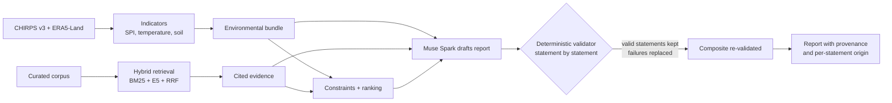

# ClimateAdapt Lab

**Evidence-grounded decision support for agricultural drought adaptation.**
Pick a place and a season. The platform computes drought-relevant indicators from satellite and reanalysis archives, retrieves cited scientific evidence, ranks adaptation options with transparent rules, and has Meta's **Muse Spark** model draft a report that **deterministic code validates statement by statement**.

> Numbers are computed, claims are cited, and uncertainty stays visible. The model explains; it never produces an authoritative number.


---

## Contents

1. [Why this exists](#why-this-exists)
2. [What it does](#what-it-does)
3. [How Meta's Muse Spark is used](#how-metas-muse-spark-is-used)
4. [Quickstart for judges](#quickstart-for-judges)
5. [Run a live analysis](#run-a-live-analysis)
6. [Docker demo stack](#docker-demo-stack)
7. [Architecture](#architecture)
8. [Scientific integrity rules](#scientific-integrity-rules)
9. [Verification status](#verification-status)
10. [Honest scope and limitations](#honest-scope-and-limitations)
11. [Data sources and licences](#data-sources-and-licences)
12. [Repository layout](#repository-layout)
13. [Developer commands](#developer-commands)

---

## Why this exists

Drought adaptation decisions (when to irrigate, which water-saving practice to try, where to focus extension work) are made by agronomists, extension officers, NGO programme staff and regional planners who need **defensible, cited** context, not an opaque score. Existing tools either show raw maps without evidence, or generate fluent text with no guarantee that numbers and citations are real.

ClimateAdapt Lab extends the author's earlier irrigation-management work (ECO DRIP, 2023) toward comparing a wider set of drought-adaptation options, with every number traceable to a data source and every claim traceable to a retrieved passage.

*Intended users: agronomists, extension and NGO staff, planners, researchers. It is decision support for an advisor, not an automated emergency declaration.*

## What it does

| Stage | What happens | How it is built |
|---|---|---|
| **Environmental indicators** | Rainfall SPI (CHIRPS v3 and ERA5-Land), temperature anomaly, soil-moisture anomaly for a chosen point, month window and reference period | Tested Python: gamma SPI (Thom fit) per calendar month, KS fit diagnostics, window anomalies; incomplete reference years are excluded and reported, never imputed |
| **Scientific evidence** | Retrieves cited passages with page ranges from a curated corpus | BM25 + dense multilingual-E5-small (Qdrant local mode) fused with Reciprocal Rank Fusion; citations are verified against the retrieved chunk |
| **Adaptation options** | Filters options by hard constraints and ranks the rest with explicit weights | Deterministic catalog, constraints and scoring; evidence strength and **unknowns shown explicitly** |
| **Report** | A nine-section structured report | Muse Spark drafts; deterministic validators check every statement; failing statements are replaced by platform-written text; full fallback if the whole report cannot be validated |
| **Interface** | Overview map, four-step analysis builder, results workspace with tabs, history, captured demo runs | React + Vite, TypeScript, Leaflet |

Example (single point, reference scenario 30.43°N, −9.61°E, Jan–Mar 2024, real data): CHIRPS SPI-3 −0.517, ERA5-Land SPI-3 −0.375, temperature anomaly +2.22 °C, soil-water-layer-1 anomaly −0.0505 m³/m³. These are one point and one season, shown with their sources and limitations. They are **not** a drought-severity verdict and the app never assigns one.

## How Meta's Muse Spark is used

- **Model:** `meta-models/muse-spark-open-1026` via Baseten's OpenAI-compatible endpoint (verified live on 2026-10-30, including a tool-call round trip).
- **Role:** drafts the structured report from deterministic tool outputs (environmental bundle, retrieved evidence, ranking). It is given the exact vocabulary it may cite and a strict numeric policy.
- **What the platform does with the draft:** a deterministic validator checks tool-output ids, every numeral, every citation, and bans efficacy and cost claims. A rejected draft gets **one repair turn** with the offending sentences. Valid statements are kept, failing ones are replaced by deterministic text, and the **composite is re-validated as a whole** before a user sees it. Each statement is labelled *model-written* or *platform-written* in the UI.
- **Observed result** (saved trace, reference scenario): the first draft was cut off at the token cap; the repair was accepted; 14 of 14 statements model-written; 2 model calls, 61,385 prompt and 23,296 completion tokens, ~102 s. Runs can also end in the deterministic fallback; the UI says so.
- **Not claimed:** structured-output enforcement (this model does not enforce a schema; validation is client-side), numeric rate limits or credit figures, or that the model chooses its own tools in the live path (the pipeline is fixed and validated by design).

Details and numbers: [`docs/MUSE_SPARK_EVIDENCE.md`](docs/MUSE_SPARK_EVIDENCE.md), [`docs/AGENT_WORKFLOW.md`](docs/AGENT_WORKFLOW.md), [`docs/LLM_PROVIDER_NOTES.md`](docs/LLM_PROVIDER_NOTES.md).

## Quickstart for judges

**Zero keys. No Copernicus account. No model key.** The demo serves captured real-data runs (clearly labelled *stored results, not a live run*), including one with an accepted Muse Spark report.

Requirements: Python 3.11 and [uv](https://docs.astral.sh/uv/), Node **20.19+** and npm (or Docker).

```powershell
# Windows PowerShell, repo root
uv sync
$env:CLIMATEADAPT_DEMO_MODE = "true"
uv run uvicorn climateadapt.api.main:app --reload
```

```powershell
# second terminal
cd frontend
npm install
npm run dev
```

macOS/Linux: use `export CLIMATEADAPT_DEMO_MODE=true` instead of the `$env:` line.

Open <http://localhost:5173>. Go to **Demo** and open a snapshot, or use **Overview** to see the captured runs on the map.

**Docker alternative** (builds the frontend with Node 22 inside the image): `docker compose up --build`, then open <http://localhost:5173>. See `docker-compose.yml` and `.env.docker.example`. <!-- [VERIFY: whether compose starts in demo mode by default, and say so here] -->

**Automated clean-clone check:** `powershell -ExecutionPolicy Bypass -File scripts/verify_fresh_clone.ps1` clones the repo, installs, starts both servers in demo mode and probes the demo endpoints.

## Run a live analysis

Live runs need real data credentials and, for the narrative, a model key. **Never commit keys.** Copy `.env.example` to `.env` and fill it in; `.env` is git-ignored.

**1. Model key (for the AI report).** Set the Baseten key in `.env` (`CLIMATEADAPT_BASETEN_API_KEY`; `BASETEN_API_KEY` is also accepted). Base URL, model ID and key variable names are configurable by environment variable so a judge can use their own key; see the table in [`docs/LLM_PROVIDER_NOTES.md`](docs/LLM_PROVIDER_NOTES.md). Without a key, the platform still returns every deterministic result and a clearly labelled **platform fallback report**. <!-- [FILL: if the hackathon issues a "Meta Model API key", state here exactly which variables to set, from docs/LLM_PROVIDER_NOTES.md] -->

CLI smoke run (guarded so it cannot spend credits by accident):

```powershell
$env:CLIMATEADAPT_RUN_LIVE_LLM = "1"
uv run python scripts/run_agent.py
```

**2. Rainfall (CHIRPS v3).** No account needed. First read of a point takes about a minute (single-pixel HTTP range reads); later reads are cached.

**3. ERA5-Land (SPI, temperature, soil moisture).** Needs a free Copernicus account, acceptance of the dataset terms, and `%USERPROFILE%\.cdsapirc` (or `~/.cdsapirc`). Requests queue for tens of seconds to minutes. `CLIMATEADAPT_ALLOW_DOWNLOADS=false` forces offline, cache-only runs.

**4. Evidence corpus.** Source documents have mixed licences, so **PDFs and extracted text are not in this repository**. Only `corpus/manifest.json` and `corpus/eval/` are versioned.

```powershell
uv run python scripts/corpus_fetch.py
uv run python scripts/corpus_ingest.py
```

Without the corpus, analyses still complete and report a typed *retrieval empty* warning instead of citing anything. Three documents must be downloaded manually; see `corpus/manifest.json`.

## Docker demo stack

Backend image (Python 3.11 slim + `uv sync`; rasterio/scipy install from
wheels, no GDAL build; the `dense` extra is excluded) and frontend image (Node
22 build, nginx serve), orchestrated by `docker-compose.yml`. Host `./data`
(caches, corpus text, sqlite) is bind-mounted so images stay small and warm
caches are reused; `.dockerignore` keeps `data/`, `.env` files, and corpus
text out of the images. No secrets in images — copy `.env.docker.example` to
the untracked `.env.docker` for overrides (a real Baseten key belongs only
there or in the shell environment):

```powershell
docker compose up --build
```

Backend: http://127.0.0.1:8000 (`/health`, `/docs`); frontend:
http://localhost:5173 (matches the backend CORS default). The backend health
check gates the frontend start. Fresh ERA5-Land downloads inside the container
need `~/.cdsapirc` mounted read-only (commented line in the compose file);
without it, cached ERA5 + CHIRPS runs work and new CDS requests fail loudly.

## Architecture



- **Pipeline (7 stages):** `validate_inputs → bundle → retrieval → ranking → draft → validate → finalize`, with a bounded call and token budget and a per-stage trace.
- **Layers import downward only:** `data/` connectors, `indicators/` pure calculations, `pipelines/`, `rag/`, `recommend/`, `llm/` provider adapter, `agent/`, `api/` (FastAPI, versioned `/v1`, OpenAPI contract in `docs/openapi.json`), `frontend/` (React + Vite).
- **Long runs** use a job pattern with polling; the UI shows stage progress and offers the captured demo as a shortcut.
- **Why a fixed pipeline, not an agent framework:** every step has a deterministic contract and a test, and the model's only job is the drafted explanation, which is validated. A graph or agent framework would add moving parts without changing what a user can trust. This was a deliberate, recorded decision.

## Scientific integrity rules

Enforced in code and tests, not just documentation:

1. Missing is never zero. Partial windows are never summed. Incomplete reference years are excluded and reported, never imputed.
2. Units are verified from file metadata; unexpected units are rejected.
3. One grid point per series. The ERA5-Land land fallback is opt-in and always reported prominently, with the distance.
4. Every result carries provenance (source, request, retrieval time, hash/ETag where available), citation, licence note and limitations.
5. No composite "drought severity" score, and no severity labels from a single indicator.
6. Synthetic, user-supplied and real data are always distinguished; captured demo runs are labelled as stored results.
7. No fabricated measurements, citations, coverage, intervention benefits or costs. Unknown stays explicitly unknown.
8. Hard constraints live in deterministic code. Model output is validated against retrieved sources and schemas before it reaches a user.
9. Tests never use the network or credentials.

## Verification status

Labels follow the repo's convention: **CONFIRMED** (run, output recorded), **REPORTED**, **UNVERIFIED**.

| Item | Status |
|---|---|
| Backend test suite (owner's machine, 2026-11-02) | **CONFIRMED**: 904 passed, 1 skipped. Later tasks added tests; rerun `uv run pytest -q` for the current count. <!-- [UPDATE with your final run] --> |
| Lint (`uv run ruff check .`) | **CONFIRMED** clean |
| Frontend (type check, lint, unit tests, build, Playwright) | **CONFIRMED** green in the build sandbox (118 unit, 9 end-to-end); run `npm run test` locally |
| CI on GitHub | **CONFIRMED** green on first run |
| Backend Docker image and `/health` | **CONFIRMED** by the owner |
| Real-data runs (CHIRPS, ERA5-Land) | **CONFIRMED** on the reference point and four coverage probes. These are coverage checks, **not global validation**. |
| Muse Spark live report accepted by validators | **CONFIRMED** (saved run `2026-11-02`, trace in the evidence file) |
| Full-stack Docker (frontend image, compose serving), fresh-clone script servers | **CONFIRMED** |
| Numeric model rate/context limits, credit balance | **UNVERIFIED** |

## Honest scope and limitations

- **ERA5-Land vs CHIRPS** can differ strongly month to month and at coastal masked points. Differences are reported, not smoothed over.
- **Computer vision is a separate, local experiment** (see below), not connected to the recommendations.
- **Not implemented:** hosted deployment, authentication and rate limiting for a public instance, PostgreSQL (SQLite stores scenarios), Airflow, Prometheus, Grafana, Evidently, Optuna, an agent-framework orchestration layer, Sentinel-2/WaPOR pipelines, area analysis, geocoding and place search.
- MLflow is used only for the vision baseline and sits outside `uv.lock`.

### Crop / non-crop vision baseline (separate experiment)

Classical models (logistic regression, random forest) trained on the CropHarvest benchmark and evaluated on its six official test grids (543,055 evaluable rows) with bootstrapped confidence intervals and a leakage audit. Random forest reaches 0.797 accuracy and 0.790 macro-F1; logistic regression 0.562 and 0.559. Per-region results vary widely and one region is near chance, which is reported. Trained on a 20,000-row seeded sample of 82,654 eligible rows; the full-data run is reproducible but not executed. It is **not** a drought or intervention model and is not deployed. See [`docs/VISION_BASELINE.md`](docs/VISION_BASELINE.md).

## Data sources and licences

| Source | Use | Terms / citation |
|---|---|---|
| CHIRPS v3 Final, monthly, 0.05°, 60°S–60°N, 1981– | Rainfall | UC Santa Barbara Climate Hazards Center; cite DOI 10.15780/G2JQ0P |
| ERA5-Land monthly means, 0.1°, global, 1950– | Rainfall, temperature, soil water | Copernicus licence; "Generated using Copernicus Climate Change Service information" |
| Curated FAO / WMO / ICARDA / journal documents | Evidence passages | Mixed licences (some NC/ND). Not redistributed here; cited with short attributed quotes only |
| CropHarvest (Zenodo record 10251170) | Vision baseline | Downloaded and checksum-verified by script; not redistributed |
| OpenStreetMap tiles | Map background | © OpenStreetMap contributors, per the Tile Usage Policy |

Code licence: **[ADD LICENSE FILE AND NAME IT HERE]**. Third-party notes: `react-leaflet` 5 is under the Hippocratic License 2.1 (not OSI-approved), recorded as an accepted exception in `docs/FINAL_VERIFICATION.md`.

## Repository layout

```text
src/climateadapt/
  data/         connectors, coverage, provenance (CHIRPS, ERA5-Land via CDS)
  indicators/   pure calculations (SPI, anomalies, units)
  pipelines/    connector + indicator workflows
  rag/          manifest, ingest, chunking, BM25, dense, RRF, citations, evaluation
  recommend/    option catalog, constraints, ranking
  llm/          provider adapter, prompts, validator, composite report
  agent/        fixed validated workflow and trace
  vision/       CropHarvest baseline (separate experiment)
  api/          FastAPI app, jobs, scenarios, demo snapshots
frontend/       React + Vite + TypeScript + Leaflet
demo/           tracked, audited demo snapshots
corpus/         manifest.json and eval/ only
docs/           handoff, verification, demo script, evidence, screenshots
scripts/        developer CLIs and the fresh-clone check
tests/          offline tests (synthetic data and fakes; no network)
```

## Developer commands

```powershell
uv sync --extra dev
uv run pytest -q          # full suite takes several minutes
uv run ruff check .
cd frontend; npm run lint; npm run test; npm run build; npm run test:e2e
```


---

*Built for the Meta AI Developer Hackathon.*